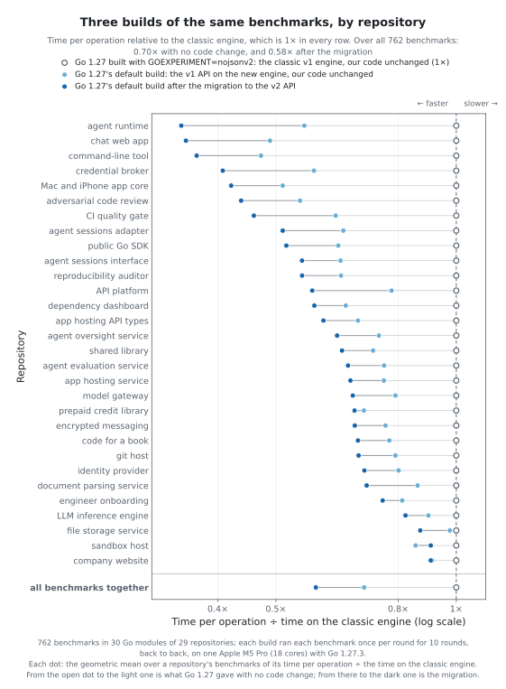
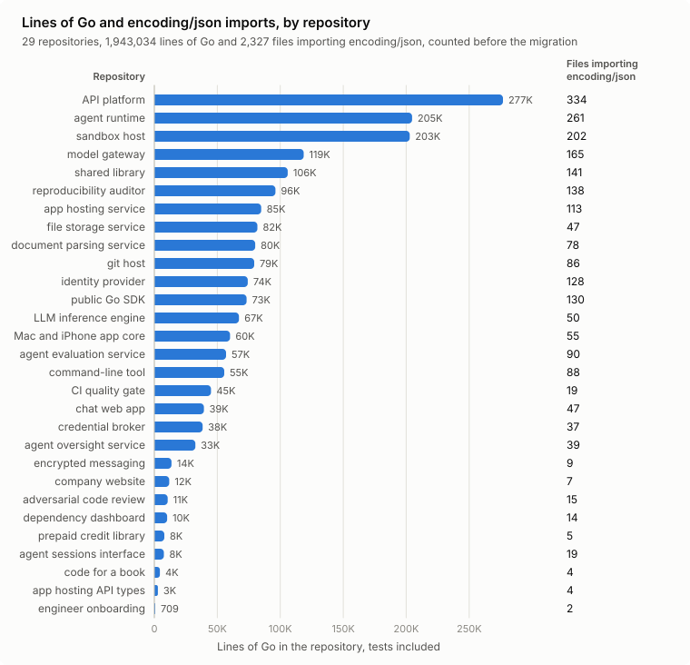
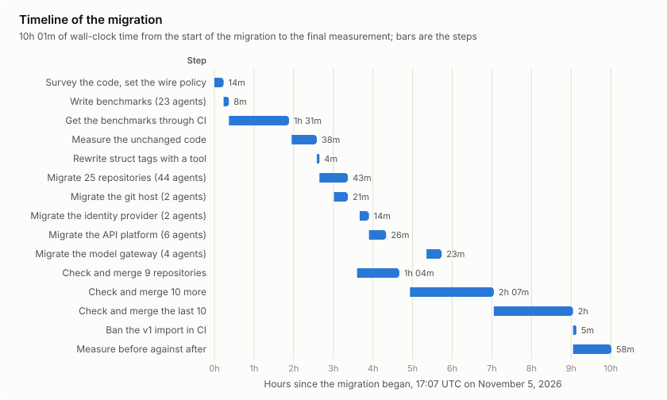
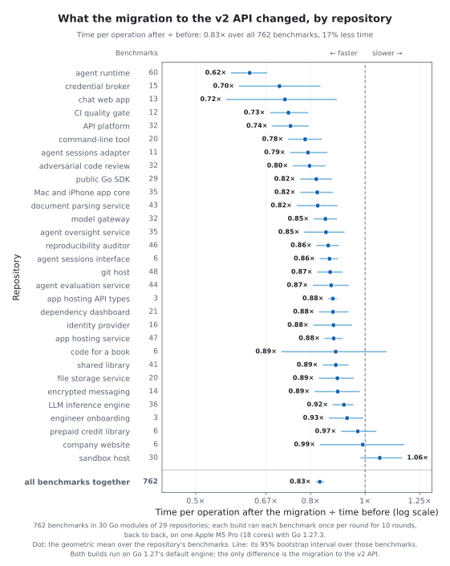
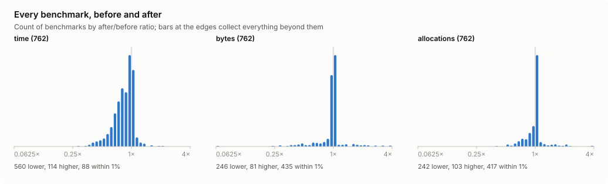
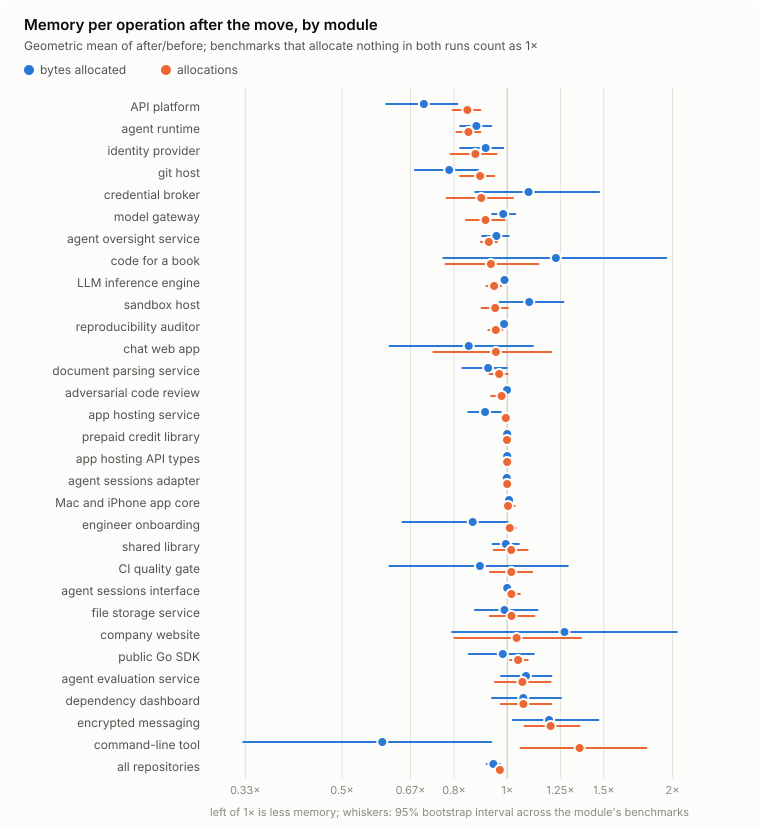

# Migrating 1.9 million lines of Go to encoding/json/v2: what got faster, and what broke

Go 1.27 ships `encoding/json/v2`, and it already runs your JSON even if you
never import it: the v1 package is now a layer over the new engine. We
wanted to know what that is worth, and what it costs to move to the v2 API
itself. So we moved all of our Go code: 29 repositories, 39 modules, 1.9
million lines of Go (tests included) and 2,327 files that imported
`encoding/json`. Before changing a line we wrote 350 benchmarks of our real
JSON paths, and we ran them again after.

The short version:

- Go 1.27 alone made our JSON code 1.4× faster, with no code change.
- Moving to the v2 API cut the time by another 17%, for 1.7× in all.
- The new API was the easy part. The work was deciding which bytes on the
  wire were allowed to change, and finding the tests that had quietly
  relied on v1 sorting map keys.

The whole move took one night: a little over nine hours from the first
survey to the last repository merged. AI agents made most of the edits, and
each repository's CI checks decided what merged. 21 of the 29 repositories
are open source; their migration commits are [linked at the end](#the-repositories).

## The results

<picture>
  <source media="(prefers-color-scheme: dark)" srcset="figures/engines-dark.svg">
  
</picture>

We compared three builds of the same benchmarks: the classic v1 engine
(Go 1.27 with `GOEXPERIMENT=nojsonv2`), Go 1.27's default, and our code
after the move. The 350 benchmark functions give 762 results with their
sub-benchmarks.

- **The toolchain alone: 1.4× faster.** With our code unchanged, the
  geometric mean time fell to 70% of the classic engine's, and allocations
  to 61%.
- **The move to the v2 API: a further 17%** (geometric mean 0.831, 95%
  interval 0.817 to 0.845). 505 benchmarks got faster and 76 slower, each
  significant over 10 paired rounds; 181 did not change.
- **In all: 58% of the time and 59% of the allocations**, 1.7× faster.

About two thirds of the gain comes with Go 1.27 itself, and one third with
the move. Most of that third is work the v1 API keeps doing on the new
engine and v2 lets a caller drop: matching member names in any letter case,
escaping `<`, `>` and `&`, sorting map keys. Some of it is code that got
simpler. Where a v1 `Decoder` read one value from bytes already in memory, a
single `Unmarshal` call does it now, and that alone made our chat web app's
event decode 3.5 times faster, with its case-insensitive matching kept.
Where we chose to keep v1's bytes, we pay for it, and that is where the 76
slower benchmarks are ([below](#where-it-got-slower)).

All numbers come from one machine (Apple M5 Pro, 18 cores, Go 1.27.3), with
each benchmark binary built once per build and the three run side by side in
10 rotating rounds. [METHOD.md](METHOD.md) has the details, [data/](data)
every raw `go test` line, and [data/final/stats.json](data/final/stats.json)
every per-benchmark statistic.

## What we moved

<picture>
  <source media="(prefers-color-scheme: dark)" srcset="figures/size-dark.svg">
  
</picture>

The code is what a company building a platform for AI agents runs: an API
platform, an agent runtime, a sandbox host on Kubernetes, a model gateway,
an identity provider, a git host, a public SDK, a command-line tool, the Go
core of a Mac and iPhone app, a shared library they all use, and more than
a dozen smaller services and libraries. The largest repository has 277,000 lines of Go; the
smallest, about 700. JSON is everywhere in them: HTTP APIs, events,
documents stored in Postgres, model-provider requests and streams,
JSON-RPC frames.

Across them the migration counted 3,138 `Unmarshal` calls, 1,789 `Marshal`
calls, 2,125 raw JSON values (`json.RawMessage`), 465 one-shot request
decodes and 304 response encodes.

## How we did it

<picture>
  <source media="(prefers-color-scheme: dark)" srcset="figures/timeline-dark.svg">
  
</picture>

One engineer and one coordinating Claude Code session ran the move. The
coordinating session surveyed the code, wrote the tools, the benchmarks'
brief and the migration guide, and handed each repository (the large ones
split by directory) to two Claude Sonnet agents: one migrated, one reviewed.
The engineer made the calls that needed a person, chiefly what the wire may
change. Nothing merged without passing the repository's full CI checks.

### 1. Decide what the wire may change

v2 differs from v1 in more than its API. Its defaults are stricter and its
output differs: nil slices encode as `[]`, map keys are not sorted, `<`,
`>` and `&` are not escaped, field names match case-sensitively, invalid
UTF-8 is an error. Each of those is right for new code, and each can break
a client, a stored digest or a third party. So before any code moved we
wrote down one policy, and held every change to it:

| Kept exactly as before | Accepted as v2's default |
|---|---|
| which fields are omitted, names and values | `[]` for a nil list in our own API responses |
| `time.Duration` as integer nanoseconds | no HTML escaping outside HTML |
| key order wherever bytes are stored, hashed, compared or sent to a model provider | unsorted map keys in API responses |
| `null` for a nil list sent to a service we don't own | case-sensitive names for our own clients |
| lenient input from anything we don't produce: duplicate names, invalid UTF-8, any letter case | new error text |

"Kept" means options at the call site. Each package names its option sets
once, and a test fails if a pin is lost:

```go
// foreignJSON reads what another system wrote, as leniently as v1 did.
var foreignJSON = json.JoinOptions(
	jsontext.AllowDuplicateNames(true),
	jsontext.AllowInvalidUTF8(true),
	json.MatchCaseInsensitiveNames(true),
)

// storedJSON writes a record whose bytes must be the same for the same value.
var storedJSON = json.JoinOptions(json.Deterministic(true), jsontext.AllowInvalidUTF8(true))

err := json.Unmarshal(body, &event, foreignJSON)
```

### 2. Benchmarks before code

The benchmarks came first, committed on their own before any code changed.
One agent per repository added `BenchmarkJSON...` functions for that
service's hot paths, called through the functions the service actually
uses, at realistic sizes: 100 files and 350 benchmark functions. Benchmark
names stay the same through the migration, so every result before pairs
with one after.

### 3. Check the toolchain, don't remember it

Every behavior a rule depended on was checked with a small probe program on
Go 1.27.3 ([tools/probe](tools/probe), [tools/rawprobe](tools/rawprobe)).
Some results were not what we expected:

- The `format:` tag option is not in the standard library's v2. A field
  carrying one makes the whole struct fail to encode, at run time.
- `time.Duration` has no default v2 representation; encoding one is an
  error.
- v1's `omitempty` goes by the Go value (false, 0, nil, empty); v2's goes by
  the JSON it would write (`null`, `""`, `{}`, `[]`). The same tag omits
  different fields.
- For a raw value, v2's `omitempty` drops `null`, `{}`, `[]` and `""`, which
  v1 kept. `omitzero` matches v1, except that a non-nil empty value is an
  error under both tags.
- `UnmarshalRead` of an empty body returns `io.ErrUnexpectedEOF`, not
  `io.EOF`. `MarshalWrite` writes no trailing newline.
- Options passed at a call site don't reach a v1-style `UnmarshalJSON`
  method.

### 4. Make the tag changes mechanical

The `omitempty` difference touches thousands of struct fields, and it is
the kind of change a person or a model gets subtly wrong. So a small tool
([tools/jsontags](tools/jsontags)) type-checks each module and rewrites
every tag by the field's type, to the tag that encodes the same under v2:

| Field | Tag change |
|---|---|
| bool, number, pointer, interface | `omitempty` to `omitzero` |
| pointer to `time.Time` | unchanged |
| raw value | `omitempty` to `omitzero` |
| string with a custom marshaler | `omitempty` to `omitzero` |
| struct value | `omitempty` removed (v1 never omitted one) |
| plain string, slice, map, array | unchanged |

```go
// before                                  // after, the same bytes under v2
Retries int       `json:"retries,omitempty"`  Retries int       `json:"retries,omitzero"`
Meta    Meta      `json:"meta,omitempty"`     Meta    Meta      `json:"meta"`
Tags    []string  `json:"tags,omitempty"`     Tags    []string  `json:"tags,omitempty"`
```

The tool ran first in every repository, so the agents started from tags
that were already right.

### 5. One agent migrates, a second one reviews

Each repository, or each directory of a large one, went to a pair of
agents:

1. A migrating agent with the guide ([GUIDE.md](GUIDE.md)): rewrite imports
   and calls, apply the wire policy at each call site, add a test for every
   pin, and report every pin, accepted change and open question in a fixed
   form.
2. A reviewing agent that read the whole diff against 11 kinds of mistake
   (a lost pin, lenient input made strict, a raw value newly omitted, a
   weakened test, and so on) and fixed what it found.

| Step | Agents | Wall time | Tokens |
|---|---|---|---|
| write the benchmarks | 23 | 7 min | 2.9M |
| migrate and review 25 repositories | 44 | 42 min | 7.0M |
| migrate and review three more, once their other releases were out | 10 | 14 to 25 min | 1.6M |
| migrate and review the model gateway | 4 | 23 min | 0.7M |

The reviewers found 136 problems and fixed 107 of them. Reading all the
reports together turned up one more. The rest they judged and left, each
with a reason. Most were about lenient input: a decode of foreign data that
had become strict about duplicate names or invalid UTF-8.

### 6. Merge only through CI

Each repository merged as one commit, `json: move to encoding/json/v2`,
after its full CI checks passed: lint, license headers, coverage floors,
the whole test suite, end-to-end suites against real Postgres and kind
clusters, and an image build. Of the 67 check runs the logs kept, 31 failed
and one was stopped, and each failure was fixed in the code or the test
before the push ([PROCESS.md](PROCESS.md) tables the causes). Other work
kept arriving in the same repositories through the night, so the merge
script rebased onto it and never pushed a commit it had not written.

### 7. Ban the v1 import

The last step was a lint rule: a Go file that imports `encoding/json` fails
CI, with a message that names the replacement. In a golangci-lint v2
configuration, with `depguard` enabled:

```yaml
linters:
  settings:
    depguard:
      rules:
        stdlib:
          list-mode: lax
          files: [$all]
          allow:  # depguard denies by prefix, so name the successors
            - encoding/json/v2
            - encoding/json/jsontext
          deny:
            - pkg: encoding/json
              desc: use encoding/json/v2 and encoding/json/jsontext; RawMessage is jsontext.Value
```

## What surprised us

**The order of the repositories mattered, though the API said it
wouldn't.** `json.RawMessage` is an alias of `jsontext.Value`, so a
migrated library still matches an unmigrated consumer's types, and the
repositories looked like they could move in any order. The wire bytes told
a different story. A migrated service that encodes a struct from an
unmigrated library applies v2's `omitempty` to the library's v1-era tags,
and fields that used to be omitted (`false`, `0`) appear. Agents saw it
locally and wrote shadow marshalers to compensate. We removed those and
went in dependency order: the shared library and the SDK first, released,
then every consumer raised to the new versions in the same commit as its
own migration. "The libraries" turned out to mean every module that another
module imports: a third one, the manifest types of our app hosting service,
had been migrated but not released, and one consumer kept copies of its
types until we released it.

**Map order was the biggest class of test failures.** v1 sorts map keys;
v2 doesn't. Every test that compared a map-built body byte for byte failed
at random: golden files, tests that re-marshal a decoded map, and, the
interesting ones, security tests asserting that a refused request reads
exactly like a request for something that doesn't exist. Those are
byte-equality tests by design. We fixed the rule rather than each test:
the shared error writer sorts its details again (error bodies are a cold
path), response shapes that are fixed became structs, and tests that
re-encode a map ask for `json.Deterministic(true)`. A three-key map comes
out in v1's order about one run in three, so one green run proves nothing.
After the move we reran every test package it touched three times: 421 of
426 passed every run, four of the other five fail the same way on the code
from before the move because they cannot repeat in one process, and the
fifth only runs past Go's 10-minute test timeout when repeated. All five
pass as separate runs.

**Escaping is part of the bytes a server compares.** v2 doesn't escape
`<`, `>` and `&`, which is harmless for anything that parses JSON, and we
had accepted it. Then one case in the sandbox host's end-to-end suite failed
on every run: a sandbox whose command held a shell redirection could not be
started again after a failure. The host guards each write of a sandbox's
record with a JSON Patch `test` operation holding the record as it read it,
and the Kubernetes API server, whose encoder still escapes the v1 way,
compares that value byte for byte with its own encoding. `a > b` and
`a > b` are the same string and different bytes, so the guard never
passed and the write was retried until it gave up. JSON sent to the cluster
now asks for v1's escaping, and a test reproduces the failure on the fake
clientset. Only one case in the whole suite had a `>` in it.

```go
// outboundJSON writes what the cluster's API reads, escaped as the API
// server's own encoder escapes, so a patch's test operation matches.
var outboundJSON = json.JoinOptions(
	json.Deterministic(true),
	json.FormatNilSliceAsNull(true),
	json.FormatNilMapAsNull(true),
	jsontext.AllowInvalidUTF8(true),
	jsontext.EscapeForHTML(true),
	jsontext.EscapeForJS(true),
)
```

**Strict reads changed what our tests saw.** Once the SDK and the shared
library read with v2's defaults, three repositories' tests failed. Two had
fakes that sent what no server of ours sends: a fixture that wrote
`created_at` twice, and a fake authorizer that answered with an untagged Go
struct holding a `time.Duration`. v1 had read both without complaint. The
third was a test request that repeated a member to check which copy a
security check reads; the request is now refused as malformed one layer
earlier, before the check runs. We fixed the fakes, let that test expect the
earlier refusal, and kept strict reads for our own wire.

**Case-sensitive names hid a silent failure in tests.** Some tests decoded
responses into untagged structs. v1 matched `Error` to `"error"` without a
tag; v2 doesn't, so the field stayed empty and the test kept passing while
checking nothing. The reviewers tagged them.

**Two tag rules were wrong at first, and only a probe showed it.** We had
first treated a pointer to `time.Time` like any pointer and moved it to
`omitzero`. That drops a non-nil pointer to the zero time, which v1 kept.
We also left raw values on `omitempty`, which under v2 drops a `null` or
`{}` that v1 kept. The probe caught both, the tool was fixed, and a script
corrected 65 fields across the repositories.

**Linters that only know v1 went quiet.** `errchkjson` and `gosec`'s
secret-marshaling check don't recognize v2 calls, so their `//nolint`
directives became unused and failed `nolintlint`. `errorlint` now flags
`err != io.EOF` after `jsontext.Decoder.ReadToken`, which v1's `Decoder`
didn't need. Raising the `go` directive to 1.27 turned on Go 1.27's own
modernizers in every file we touched.

**A library that supports older Go releases has to drop them.** Our public
SDK supported the two newest Go releases. `encoding/json/v2` exists only
from 1.27, so its floor moved to Go 1.27, released as a breaking change.

## The numbers in detail

<picture>
  <source media="(prefers-color-scheme: dark)" srcset="figures/per-repo-dark.svg">
  
</picture>

25 of the 29 repositories got faster, with the whole 95% interval of their
geometric mean below 1. The largest gains are in the services whose hot
paths carry model and tool traffic: the agent runtime went to 0.62 of its
time, the credential broker to 0.71, the chat web app to 0.72. Three small
repositories with six benchmarks each show no clear change (the company
website at 0.99, the code for a book at 0.89 and the prepaid credit library
at 0.97, each interval crossing 1).

The sandbox host is the exception: 12 benchmarks faster, 12 slower, 1.06
overall. To keep durations as integer nanoseconds on its worker protocol,
the migration wrapped two message types in v1-style `MarshalJSON` methods,
and its state messages took 1.9 times as long as before. Giving the state
type v2's own `MarshalJSONTo`, which writes into the caller's encoder
instead of returning bytes the encoder must check and copy, brought that to
1.26 times in a scratch copy. The v1-style method is most of the cost; the
rest we have not traced.

```go
// v1 style: returns bytes, which the v2 encoder then validates and copies.
func (s State) MarshalJSON() ([]byte, error) {
	type alias State
	return json.Marshal(struct {
		alias
		AutoStop int64 `json:"autoStop,omitzero"`
	}{alias(s), int64(s.AutoStop)})
}

// v2 style: writes straight into the caller's encoder.
func (s State) MarshalJSONTo(enc *jsontext.Encoder) error {
	type alias State
	return json.MarshalEncode(enc, struct {
		alias
		AutoStop int64 `json:"autoStop,omitzero"`
	}{alias(s), int64(s.AutoStop)})
}
```

The migration added v1-style methods in three files, two of them these;
everywhere else the agents wrote 32 methods of v2's kind.

### Where it got slower

<picture>
  <source media="(prefers-color-scheme: dark)" srcset="figures/distribution-dark.svg">
  
</picture>

Per benchmark the median ratio is 0.86, and the middle 80% run from 0.62 to
1.02. The slower benchmarks cluster where the code keeps v1's bytes or
behavior and pays for it: sorted map keys in a file that is stored and
compared (a cache file, 1.36 times the time), the v1-style methods above,
and a `jsontext.Decoder` built for each small body. One service builds that
decoder to read only the first value, which needs it. Another builds it to
refuse text after the value, which v2's `Unmarshal` already does on its own,
and that request decode takes 1.68 times as long:

```go
// Slower: a Decoder per request body, only to refuse trailing text.
dec := jsontext.NewDecoder(bytes.NewReader(body))
err := json.UnmarshalDecode(dec, &req)
// then check that dec has nothing left

// Faster, and the same check: Unmarshal refuses text after the value.
err := json.Unmarshal(body, &req)
```

Where a pin sits on a benchmarked path, its price is now measured, and the
next change to it can be weighed against that.

<picture>
  <source media="(prefers-color-scheme: dark)" srcset="figures/memory-dark.svg">
  
</picture>

Memory moved less than time. Against Go 1.27's default, the move saved 6%
of the bytes and 3% of the allocations per operation (geometric means 0.944
and 0.970, intervals 0.918 to 0.969 and 0.954 to 0.987); most of the
allocation savings had already come with the toolchain, which alone brought
allocations to 0.61 of the classic engine's. The API platform and the git
host saved the most bytes. The command-line tool is the outlier: 0.60 of
the bytes in 1.36 times as many allocations.

## If you are planning your migration

1. **Upgrade to Go 1.27 first, and measure.** Two thirds of our gain came
   from the toolchain, with no code change. If JSON is a small share of
   your service's time, that may be all you need for now.
2. **Write down what your wire may change before you change code.** List
   where bytes are stored, hashed, compared or sent to someone else's
   server, and pin those with named option sets and a test each.
3. **Fix `omitempty` by type, with a tool.** The same tag omits different
   fields under v2, and thousands of fields is too many to do by hand.
4. **Go in dependency order.** Migrate and release every module that other
   modules import before its consumers; until then a migrated consumer
   writes the library's types with v2 rules.
5. **Expect map order in your tests, and rerun them.** One green run proves
   nothing about a random order.
6. **Look for peers that compare bytes.** The Kubernetes API server's JSON
   Patch `test` operation, caches keyed by a body, signatures over JSON.
   Those need v1's escaping or sorted keys.
7. **Write custom marshalers the v2 way.** `MarshalJSONTo` and
   `UnmarshalJSONFrom` instead of v1-style methods; `Unmarshal` instead of a
   `Decoder` for bytes already in memory.
8. **Ban the v1 import when you're done,** so new code starts on v2.

## Looking back

For us the move was worth it. The speed came mostly from Go 1.27 itself,
and the API change added a measurable third on top. What it bought besides
speed is JSON behavior that is written down: every place where our bytes
must match v1's now says so at the call site, with a test, instead of
depending on a default nobody chose. The work was rarely the new API. It
was the policy, the libraries' order, and the tests in nine repositories
that had depended on v1's sorted maps without saying so. The v1-style
methods in three files and one needless `Decoder` are still to convert, and
the benchmarks will show what converting them is worth.

## The repositories

| Repository | Lines of Go | Files on v1 | Migration commit |
|---|---:|---:|---|
| API platform (private) | 276,829 | 334 | private |
| agent runtime ([topos](https://github.com/latere-ai/topos)) | 204,682 | 261 | [ebc9718](https://github.com/latere-ai/topos/commit/ebc9718ea2c3c701617a3cdba26fa43df83630e5) |
| sandbox host ([cella](https://github.com/latere-ai/cella)) | 202,762 | 202 | [bbd93c1](https://github.com/latere-ai/cella/commit/bbd93c10bb39dcf1ff475111399649906d5e1c60) |
| model gateway ([lux](https://github.com/latere-ai/lux)) | 118,585 | 165 | [e424ca9](https://github.com/latere-ai/lux/commit/e424ca9f89c69188c5840de7177fa5b96c812bf1) |
| shared library ([pkg](https://github.com/latere-ai/pkg)) | 105,870 | 141 | [92321b8](https://github.com/latere-ai/pkg/commit/92321b8673ac8ef8fa5d380f9fd576a9a6a84d2e) |
| reproducibility auditor ([replichai](https://github.com/latere-ai/replichai)) | 96,144 | 138 | [a8610d8](https://github.com/latere-ai/replichai/commit/a8610d82bdace7091ee674b1058355cb7855d8b6) |
| app hosting service (private) | 84,847 | 113 | private |
| file storage service ([arca](https://github.com/latere-ai/arca)) | 81,798 | 47 | [ab4f6f0](https://github.com/latere-ai/arca/commit/ab4f6f0092d9a99fc52a9bcf23a28b3a38eaca35) |
| document parsing service ([lectio](https://github.com/latere-ai/lectio)) | 80,092 | 78 | [2080b21](https://github.com/latere-ai/lectio/commit/2080b21913c85d85146554f6f07d24171a784a40) |
| git host ([origo](https://github.com/latere-ai/origo)) | 79,313 | 86 | [481a0d3](https://github.com/latere-ai/origo/commit/481a0d3dc728144afa47fd45b275e09d40497b8d) |
| identity provider (private) | 74,208 | 128 | private |
| public Go SDK ([sdk-go](https://github.com/latere-ai/sdk-go)) | 73,227 | 130 | [7f0e0a6](https://github.com/latere-ai/sdk-go/commit/7f0e0a625ef9914e338a5196f709d5f75d224af5) |
| LLM inference engine ([forma](https://github.com/latere-ai/forma)) | 67,153 | 50 | [becdc84](https://github.com/latere-ai/forma/commit/becdc8473804188751657a522d02ef4e5bfa2e33) |
| Mac and iPhone app core (private) | 60,110 | 55 | private |
| agent evaluation service ([examen](https://github.com/latere-ai/examen)) | 56,965 | 90 | [d5a9827](https://github.com/latere-ai/examen/commit/d5a98273f8fa783f51c1e809357d9fef98f69e07) |
| command-line tool ([latere-cli](https://github.com/latere-ai/latere-cli)) | 55,487 | 88 | [00ffaf0](https://github.com/latere-ai/latere-cli/commit/00ffaf04cdcc58850be27a9c90866d6b5a16c6a7) |
| CI quality gate ([ci-gate](https://github.com/latere-ai/ci-gate)) | 44,994 | 19 | [6cdcd79](https://github.com/latere-ai/ci-gate/commit/6cdcd79a2e69c32b764a12688944145c4368c185) |
| chat web app (private) | 39,354 | 47 | private |
| credential broker ([pons](https://github.com/latere-ai/pons)) | 38,375 | 37 | [d249a6f](https://github.com/latere-ai/pons/commit/d249a6fc121bd18c098f35012382ca60a38a0bcf) |
| agent oversight service ([limen](https://github.com/latere-ai/limen)) | 32,558 | 39 | [782e890](https://github.com/latere-ai/limen/commit/782e89041653aa257e5125091b4a35fc21103bc1) |
| encrypted messaging ([sermo](https://github.com/latere-ai/sermo)) | 13,658 | 9 | [50eb374](https://github.com/latere-ai/sermo/commit/50eb37408df5e9c4098e27beb9999ca0fd3bdd20) |
| company website (private) | 11,820 | 7 | private |
| adversarial code review ([agon](https://github.com/latere-ai/agon)) | 10,609 | 15 | [3a523a0](https://github.com/latere-ai/agon/commit/3a523a0087ccce368420371a6fb02f2e2c489abb) |
| dependency dashboard (private) | 10,173 | 14 | private |
| prepaid credit library ([pay](https://github.com/latere-ai/pay)) | 7,915 | 5 | [0075461](https://github.com/latere-ai/pay/commit/00754619ca06a5134ffc5c6083bbeaab43aeaeba) |
| agent sessions interface ([managed-agents](https://github.com/latere-ai/managed-agents)) | 7,563 | 19 | [33131b5](https://github.com/latere-ai/managed-agents/commit/33131b5a4790df3f3fbf397933f5a15cc5d3479b) |
| code for a book ([ai-as-an-infrastructure](https://github.com/latere-ai/ai-as-an-infrastructure)) | 4,397 | 4 | [a0b02a2](https://github.com/latere-ai/ai-as-an-infrastructure/commit/a0b02a2bce6697c9de555c1ccaf86870a5ce75e7) |
| app hosting API types ([apps](https://github.com/latere-ai/apps)) | 2,837 | 4 | [8bbbf70](https://github.com/latere-ai/apps/commit/8bbbf708b9719c89725c20050743d60927cf924e) |
| engineer onboarding (private) | 709 | 2 | private |

Private repositories are counted in every figure, but their code is not
published.

## Method and data

### How to read the numbers

- A ratio is after / before: 0.70 means the after side takes 70% of the
  time, 30% less.
- Each benchmark's ratio is the median of its 10 per-round ratios. A
  benchmark counts as faster or slower only if an exact sign test over the
  10 rounds says so at the 5% level (at least 9 of 10 rounds in the same
  direction).
- A repository's or the whole set's figure is the geometric mean of its
  benchmarks' ratios, with a 95% bootstrap interval over the benchmarks.
- Benchmarks measure JSON in isolation. A handler that spends most of its
  time in a database sees a smaller share.

### Reproduce it

The scripts in [scripts/](scripts) run against checkouts of the
repositories (`ROOT` names the directory that holds them); 21 of the 29 are
public. The raw results for all 29 are in [data/](data).

1. `scripts/final-shas.sh` finds each repository's migration commit and its
   parent ([data/shas-before.txt](data/shas-before.txt),
   [data/shas-after.txt](data/shas-after.txt)).
2. `scripts/trees.sh trees/before data/shas-before.txt` and the same for
   `after` export clean trees of both.
3. `scripts/bench-paired.sh out 10 100ms base=trees/before
   classic=trees/before:nojsonv2 after=trees/after` builds and runs.
4. `go run ./tools/analyze -paired -pairs classic:base,base:after,classic:after
   -out stats.json base=out/base classic=out/classic after=out/after`
   computes the statistics, and `go run ./tools/figures -stats stats.json
   -census data/census-pre.tsv -timeline data/timeline.tsv
   -names data/names.tsv` draws the figures.
5. `scripts/flake.sh trees/after data/shas-after.txt flake` reruns every
   test package the migration changed three times
   ([data/flake/](data/flake)).

[PROCESS.md](PROCESS.md) is the full log of the night: every step, every
CI failure and its fix, in our own working vocabulary.
